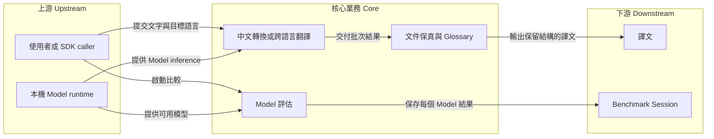
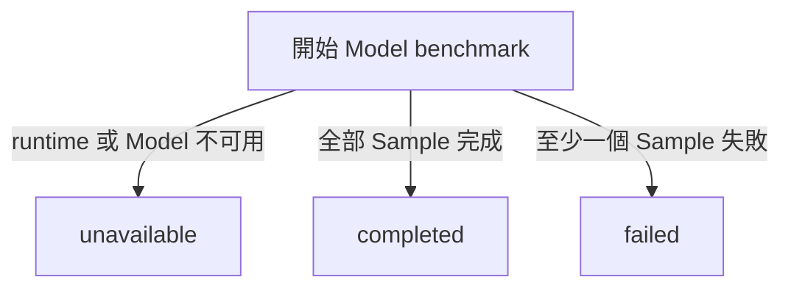

# translate — 業務分析 (Business Analysis)

## 業務目的 (Purpose)

`translate` 讓使用者與上游系統以一致介面完成中文地區化與跨語言翻譯，
同時保留文件結構、譯文來源與失敗原因。主要價值是降低人工整理逐字稿與文件的成本，
並避免未知 Model 或 silent fallback 讓譯文品質失去可追溯性。

## 常見業務操作 (Common Operations)

- 將簡體中文轉成台灣繁體中文與台灣地區用語。
- 將文字或文件翻成指定語言。
- 以 Glossary 統一財經、產品或專案專有詞。
- 檢查 Model 與 runtime 是否已就緒。
- 安裝本機 NMT Model，或選擇既有本機模型服務。
- 對全部已知 Model 執行同一個 Benchmark Session，保存可比較結果。

## 上下游服務 (Upstream / Downstream)

`上游 (Upstream):` CLI argument、stdin、文字檔與 SDK caller；可選的本機 Model runtime。

`本體 (Core):` 語言路由、Conversion / Translation、Glossary、Document preservation、
Model readiness 與 Benchmark orchestration。

`下游 (Downstream):` stdout、輸出檔、SDK return value 與 Benchmark Session artifacts。

## 狀態與流程 (Status / Flow)

一般 Conversion / Translation 沒有持久狀態機：成功時回傳完整結果，失敗時直接回報原因。
Benchmark Model Result 使用三個持久狀態：`completed`、`unavailable`、`failed`。

## 業務約束 (Constraints)

- 同一語言的中文地區化使用 deterministic Conversion，不交給神經模型自由改寫。
- 未指定 Model 時可以路由；一旦 Model 選定，失敗不得 silent fallback。
- Document Reassembly 必須保留空白與段落，且 Batch 數量必須完整對齊。
- 句級 NMT Model 一次只處理一句，避免多句輸入被 runtime 靜默遺漏。
- Glossary 在 Engine output 後套用，避免替換結果再次被字典改寫。
- Benchmark 必須對全部 Model 使用相同 Sample corpus，並拒絕覆寫既有 Session。

約束正名與狀態值見 [docs/terminology.md](docs/terminology.md)，技術 enforcement 見
[CLAUDE.md](CLAUDE.md)。

## 風險偵測 (Risk Detection)

| 風險類別 | 結論 | 說明 |
| --- | --- | --- |
| 身分／合規 (KYC/AML) | 不適用 | 未處理身分驗證、金流或受管制交易 |
| 隱私 (Privacy) | 有 | 預設 runtime 位於 localhost；caller 覆寫 endpoint 時可能把文字送往其他位置 |
| 資料完整性 | 有，已設防 | Batch 數量不符即失敗；不以 partial output 假裝成功；Benchmark Session 不覆寫 |
| 依賴風險 | 有 | 跨語言 Model runtime 或模型檔缺席時業務不可用，但 Health Check 會明確區分原因 |

## 核心業務 (Core Business)

- 中文轉換：將字形與地區用語轉為指定中文變體。
- 跨語言翻譯：以指定或路由後的 Model 產生目標語言文字。
- 文件保真：在多批處理後維持段落、空白與輸出順序。

## 非核心業務 (Non-core Business)

- Model readiness：降低 runtime 未啟動或 Model 未安裝造成的診斷成本。
- Benchmark：支援 Model 選型與品質比較，不直接產生最終業務譯文。
- Model installation：準備本機推論能力，支撐核心 Translation。
- Configuration 與 process setup：提供可重複的本機操作環境，不改變翻譯語意。
